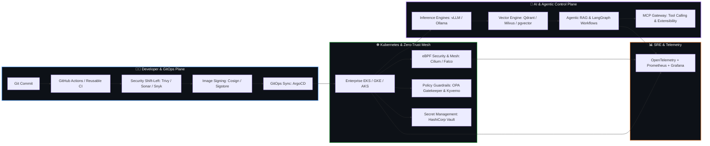

  <!-- Dynamic Header Banner -->
  

  <!-- Dynamic Typing SVG Headline -->
  

  

    <strong>Hardening Infrastructure • Accelerating Delivery • Engineering Intelligent Agentic Systems</strong>
  

  <!-- Quick Social Badges -->
  

    
    
    
    
  

---

### 🌐 Executive Summary

> *"If it’s not automated, it’s broken. If it’s not verified, it’s compromised. If it cannot reason autonomously, it belongs to yesterday."*

I am a **Senior DevSecOps & AI Platform Engineer** operating at the convergence of **Zero-Trust Cloud Infrastructure**, **High-Throughput Kubernetes Platforms**, and **Next-Generation Autonomous AI Systems (LLMOps / Agentic RAG / MCP)**.

- 🛡️ **DevSecOps Pioneer**: Designing enterprise-scale SLSA Level 3 supply chains, automated SAST/DAST/SCA security gates, eBPF-powered runtime detection, and continuous compliance.
- ☸️ **Cloud Native Architect**: Provisioning resilient multi-cloud foundations across AWS, GCP, and Azure using GitOps, Terraform/OpenTofu, and Kubernetes.
- 🤖 **AI Platform & LLMOps Engineer**: Engineering production AI platforms — orchestrating multi-agent loops (LangGraph, CrewAI), Model Context Protocol (MCP) tool fabrics, high-performance RAG pipelines, and self-hosted model inference (vLLM, Ollama, Triton).

---

### 🏛️ Platform Architecture Blueprint

Below is an architectural view of an end-to-end continuous security, cloud infrastructure, and autonomous AI services integration into a unified production control plane:

---

### 🛠️ Technical Arsenal & Core Competencies

<table>
  <tr>
    <td width="50%" valign="top">
      <h4>🤖 AI Platform, LLMOps & Agents</h4>
      
      
      
      
      
      
      
      
      
      
      
    </td>
    <td width="50%" valign="top">
      <h4>🛡️ DevSecOps & Shift-Left Security</h4>
      
      
      
      
      
      
      
      
      
      
    </td>
  </tr>
  <tr>
    <td width="50%" valign="top">
      <h4>☸️ Cloud Native, Containers & GitOps</h4>
      
      
      
      
      
      
      
      
      
      
    </td>
    <td width="50%" valign="top">
      <h4>📊 Cloud Infrastructure & Observability</h4>
      
      
      
      
      
      
      
      
      
      
    </td>
  </tr>
</table>

---

### 🚀 Key Focus & Specialized Engineering Pillars

<b>1. Model Context Protocol (MCP) & AI Agent Orchestration</b>

 
Architecting dynamic MCP client-server backplanes enabling autonomous LLM agents to securely interact with production infrastructure, private data lakes, and runtime APIs:
<ul>
  <li><b>Standardized Context</b>: Exposing infrastructure state (Kubernetes pods, AWS resources, CI/CD telemetry) via unified MCP tools.</li>
  <li><b>Multi-Agent Resilience</b>: State-machine routing via <code>LangGraph</code> with dynamic fallback and loop prevention.</li>
  <li><b>Guardrailed Tool Execution</b>: Token-based least-privilege RBAC for LLM function calls.</li>
</ul>

<b>2. Enterprise Production-Grade RAG (Retrieval-Augmented Generation)</b>

 
Building sub-second, enterprise-grade vector retrieval engines resistant to hallucination and data leakage:
<ul>
  <li><b>Hybrid Search & Dense Retrieval</b>: Combining BM25 sparse search with dense embeddings in <code>Qdrant</code> & <code>pgvector</code>.</li>
  <li><b>Self-RAG & Agentic Verification</b>: Post-retrieval reranking (Cohere/BGE), contextual compression, and automated claim verification.</li>
  <li><b>Data Governance & Tenant Isolation</b>: Partition-level encryption, row-level security (RLS), and automated pipeline ingestion.</li>
</ul>

<b>3. Zero-Trust DevSecOps & Supply Chain Hardening</b>

 
Embedding security verification at every phase of the Software Development Lifecycle:
<ul>
  <li><b>Cryptographic Attestation</b>: Signing container images and SBOMs (Software Bill of Materials) using <code>Cosign</code> and <code>Rekor</code>.</li>
  <li><b>Runtime Introspection</b>: Leveraging <code>eBPF</code> (Cilium & Falco) for kernel-level anomaly detection and network policy enforcement.</li>
  <li><b>Admission Control</b>: Restricting cluster deployment via immutable <code>OPA Gatekeeper</code> and <code>Kyverno</code> policies.</li>
</ul>

---

### 💡 Featured Architectures & Repositories

| Repository | Focus Area | Tech Stack | Highlights |
| :--- | :--- | :--- | :--- |
| **`ai-platform-control-plane`** | AI Infrastructure & MCP | `Python` `LangGraph` `MCP` `vLLM` `K8s` | Multi-agent control plane with dynamic Model Context Protocol routing & RBAC enforcement. |
| **`enterprise-devsecops-k8s`** | DevSecOps & Cloud Native | `ArgoCD` `Terraform` `Cosign` `Cilium` `Kyverno` | Hardened multi-tenant Kubernetes platform with SLSA Level 3 CI/CD verification. |
| **`agentic-rag-engine`** | LLMOps & Retrieval | `Qdrant` `FastAPI` `LangChain` `Docker` | Low-latency hybrid RAG engine with contextual reranking and self-healing query expansion. |
| **`terraform-multicloud-mesh`** | Infrastructure as Code | `OpenTofu` `AWS` `GCP` `HashiCorp Vault` | Zero-trust multi-cloud infrastructure blueprint with dynamic secrets and audit telemetry. |

---

### 📈 GitHub Telemetry & Activity Metrics

  <table border="0">
    <tr>
      <td>
        
      </td>
      <td>
        
      </td>
    </tr>
    <tr>
      <td colspan="2" align="center">
        
      </td>
    </tr>
  </table>

---

### 🐍 GitHub Contribution Snake

  

---

### 🤝 Let's Connect & Collaborate

  

    Whether you want to discuss <b>Enterprise DevSecOps transformations</b>, <b>Agentic AI Platforms & MCP Architectures</b>, or <b>Large-Scale Kubernetes Resilience</b> — feel free to reach out!
  

  
  

    
    
    
  

   

  

  

    Crafted with passion, zero-trust discipline, and agentic intelligence. ⚡
  

