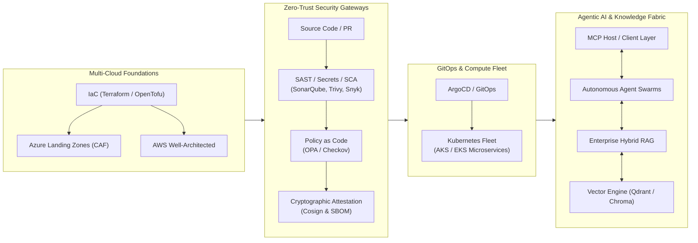

<div align="center">

<table border="0">
  <tr>
    <td align="center" width="200" valign="middle">
      
    </td>
    <td align="left" valign="middle">
      <a href="https://github.com/Ashu02412">
        
      </a>
      <p>
        <strong>Architecting Resilient Cloud Foundations • Enforcing Zero-Trust Security • Scaling Autonomous Agentic AI</strong>
      </p>
    </td>
  </tr>
</table>

<!-- Badges Row -->
<p align="center">
  
  
  
  
</p>

---

</div>

## 🌌 About Me & The Mission

```yaml
identity:
  name: "Ashu Dixit"
  role: "Senior DevSecOps & AI Platform Engineer"
  location: "Global / Remote"
  credentials: "Multi-Cloud Architect | DevSecOps Evangelist | GenAI Systems Builder"
  mission: "Bridging mission-critical cloud infrastructure, shift-left security, and autonomous intelligence."

core_dna:
  cloud_platforms: ["Azure (CAF Landing Zones)", "AWS", "Google Cloud Platform"]
  security_posture: "Zero-Trust | Continuous Compliance | Supply Chain Security (SLSA/SBOM)"
  ai_frontier: ["Model Context Protocol (MCP)", "Autonomous Agent Swarms", "Enterprise RAG", "Vector Architectures"]
  automation_ethos: "If it has to be done more than once, automate, secure, and monitor it."
```

---

## 🛠️ Unified Technology & Innovation Stack

<table>
  <tr>
    <td width="50%" valign="top">

### 🛡️ DevSecOps & Cloud Engineering
* **Cloud Providers**: Azure (Landing Zones, CAF), AWS, GCP
* **Infrastructure as Code**: Terraform, OpenTofu, Terragrunt, Ansible, Bicep
* **Containers & Orchestration**: Kubernetes (AKS, EKS, GKE), Docker, Helm, Kustomize
* **GitOps & Delivery**: ArgoCD, FluxCD, GitHub Actions, GitLab CI, Azure DevOps
* **Security & Governance (Shift-Left)**:
  * *SAST & SCA*: SonarQube, Snyk, Semgrep, Trivy
  * *Policy-as-Code*: OPA (Open Policy Agent), Gatekeeper, Kyverno, Checkov
  * *Supply Chain & Secrets*: Cosign, Syft (SBOM), HashiCorp Vault, Azure Key Vault

</td>
<td width="50%" valign="top">

### 🧠 AI Platform, Agents & GenAI
* **Agentic Orchestration**:
  * **Model Context Protocol (MCP)**: Custom tool servers, resource providers, agent prompts
  * **Autonomous Swarms**: Multi-agent collaborative workflows, LangGraph, AutoGen, CrewAI
* **Enterprise RAG & Knowledge Retrieval**:
  * Hybrid Search (BM25 + Dense Embeddings), Cohere / Cross-Encoder Re-ranking
  * Chunking Strategies, Context Enrichment, Query Rewriting
* **Vector Stores & Data Layer**: ChromaDB, Pinecone, Qdrant, Milvus, pgvector
* **LLMOps & Serving**: vLLM, Ollama, Hugging Face, Langfuse, LiteLLM, MLflow
* **Core Languages**: Python, Bash, Go, PowerShell, HCL

</td>
  </tr>
</table>

<div align="center">

### 🧰 Technology Badges

<!-- Cloud & IaC -->


<br/>

<!-- DevSecOps & Security -->


<br/>

<!-- AI & MLOps -->


</div>

---

## 🏛️ Reference Architecture: Autonomous DevSecOps & AI Platform



---

## 🚀 Key Architectural Pillars & Repositories

| Domain | Focus Area | Key Repositories & Implementations |
| :--- | :--- | :--- |
| **Cloud & Kubernetes Infra** | Enterprise Azure Hub-and-Spoke Microservices Topology | [`azure-microservices-infrastructure`](https://github.com/Ashu02412/azure-microservices-infrastructure) • [`Azure-Landing-Zone`](https://github.com/Ashu02412/Azure-Landing-Zone) |
| **Application Architecture** | Modular Monolith, Blue/Green CI/CD & Strangler Fig Migration | [`enterprise-modular-monolith`](https://github.com/Ashu02412/enterprise-modular-monolith) |
| **DevSecOps & Supply Chain** | End-to-End Zero-Trust CI/CD, SAST, SBOM & Cosign Attestation | [`enterprise-devsecops-pipeline`](https://github.com/Ashu02412/enterprise-devsecops-pipeline) • [`azure-aws-gcp-devsecops-mlops-batch-18`](https://github.com/Ashu02412/azure-aws-gcp-devsecops-mlops-batch-18) |
| **AI Platform & MCP** | Model Context Protocol (MCP) Server for Cloud & K8s Triage | [`mcp-devops-agent`](https://github.com/Ashu02412/mcp-devops-agent) |
| **Enterprise GenAI & RAG** | Hybrid Search (Dense+BM25), Cross-Encoder Reranking on K8s | [`enterprise-rag-platform`](https://github.com/Ashu02412/enterprise-rag-platform) |

---

## 📊 Live GitHub Telemetry

<div align="center">

<table border="0">
  <tr>
    <td align="center" width="50%">
      
    </td>
    <td align="center" width="50%">
      
    </td>
  </tr>
  <tr>
    <td colspan="2" align="center">
      
    </td>
  </tr>
</table>

</div>

---

## 🤝 Connect & Collaborate

<div align="center">

Let's discuss **DevSecOps transformation**, **cloud landing zones**, **Model Context Protocol (MCP)**, or **production RAG architectures**:

<p align="center">
  <a href="mailto:ashu05.dixit@gmail.com">
    
  </a>
  <a href="https://github.com/Ashu02412">
    
  </a>
  <a href="https://www.linkedin.com/in/ashu-dixit-a88074406/" target="_blank">
    
  </a>
</p>

```bash
echo "Automate the repetitive. Guard the perimeter. Scale autonomous intelligence."
```


</div>
